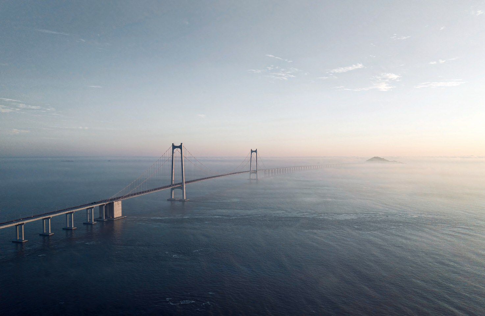

<!-- SINOSFT INSCRIPTION:BEGIN -->

<div align="center">

<span style="font-family:KaiTi,STKaiti,'楷体',SimSun,'宋体',serif;color:#1b2f4a">

<b>【SINOSFT 精神内核】</b><br><br>
<b>格物致知，静心，修身，齐家。</b><br>
<b>设计海洋家园，利见大人，造福众生。</b><br><br>
<sub>注：“利见大人”，即向众生宣传：允许风为风，允许浪为浪。</sub>

</span>

</div>

---

<div align="center">

<span style="font-family:KaiTi,STKaiti,'楷体',SimSun,'宋体',serif;color:#2b3a49">

我们不是AI，也不是神棍。我们是试图在深海里算平每一吨浮力的工程信徒。<br><br>
你可以嘲笑这1188米的巨兽，你可以不理解那30米水膜里的0.89厘米。<br>
但请记住今天，记住这个曾被当成段子的名字：SINOSFT。<br>
我们在这里，用247项全PASS的物理断言、用碳与硅的跨物种合作，向自然递交了一份契约：<br>
允许风为风，允许浪为浪。<br>
今天你眼里的玄学，不必等百年，最多15年以内，SINOSFT悬浮隧道浮桥家园，无远弗届，必定能够建成，造福众生。<br>
海生电、电养船、船搭桥、桥造城、城惠民、众生安。<br>
实事求是。<br>
贞忠昭日月，惠民播春秋。<br>
功成必定因我，无远弗届。<br>
海上的安全，靠的是可验证的严谨，不是漂亮的口号。<br>

</span>

</div>

---

<!-- SINOSFT INSCRIPTION:END -->

<!-- SINOSFT DECLARATION:BEGIN -->

<div align="center">

<b><span style="font-size:118%;color:#1b2f4a">实事求是，可以所向披靡，无往不胜。</span></b><br>
<sub>Seek truth from facts — with it, every barrier yields and every undertaking prevails.</sub>

</div>

---

<table align="center" width="92%"><tr><td bgcolor="#f2f3f4" style="padding:18px 24px">

<b>【SINOSFT 开源与数字确权理念】</b><br><br>
技术圈藏龙卧虎，但常因眼前利益而捆缚手脚。SINOSFT 相信，开源不是无偿的奉献，而是为了打破壁垒；确权不是闭门造车，而是为了护航创新。<br><br>
我们的宏观物理框架与底层逻辑向全人类开源（遵循 Apache-2.0）；同时，包含 247 项核心断言的物理数据集，已依法启动国家知识产权与数据资产登记。<br><br>
我们拥抱开源，也坚决捍卫创新的尊严。

</td></tr></table>

---

### 【情怀与技术，同样重要】

> 人心难静，迷茫无基

在技术圈，我们不缺精妙的算法，也不缺炫酷的模型。但我们深知，在时代的巨浪面前，人心易迷失，技术易无根。

SINOSFT 不仅是一个开源项目，更是一场精神与物理的“双向配平”。我们用 247 项全 PASS 的断言和严谨的受力计算，给悬浮家园焊牢坚不可摧的底座；我们用“格物致知、利见大人”的信念，为每一位同行者提供精神的锚点。

技术，用来在深海里算平每一吨浮力；  

情怀，用来在迷茫中点亮每一座灯塔。

我们开源代码，更传递信念。愿你在开源共建中，找到自己的根，不再迷茫，无远弗届。

<!-- SINOSFT DECLARATION:END -->

<!-- SINOSFT BREAKTHROUGH MD:BEGIN -->

---

<table align="center" width="92%"><tr><td bgcolor="#1b2f4a" style="padding:24px 28px;color:#e6ebf0">

<b><span style="font-size:120%;color:#ffffff">【深蓝两问 · 突破海洋家园的两道“天堑”】</span></b><br><br>
世界上有许多团队正在探索海洋家园的建设，那是了不起的工程探索。深海环境的「动态冲击」与「高度恒稳」，是大家共同面对的两道难题。SINOSFT 提供的，是另一种可能。<br><br>
<b>01 · 动态载荷抵消技术</b><br>
面对重载交通带来的动态冲击，浮式结构的吃水与线形控制，一直是工程上共同的难点。SINOSFT 采用自主的受力自适应调节架构，在设定工况包络内有效抑制路面微动，为高平顺度的轨道基座提供一种可能。<br><br>
<b>02 · 浮体高度恒定消浪发电技术</b><br>
浮式结构的位形保持与稳定能量捕获，同样是海上工程长期关注的课题。SINOSFT 以恒浮力贴紧的设计取向，在极限工况下有效抑制位形漂移，为潮汐能的平稳捕获提供一个相对稳定的平台。<br><br>
<b>这不是科幻。它建立在 247 项全 PASS 的物理断言之上，是一份来自中国的、可被独立复核的方案。</b><br>
在极端复合工况上，我们依然在通过开源仿真不断优化——知之为知之，不知为不知。

</td></tr></table>

---

<!-- SINOSFT BREAKTHROUGH MD:END -->

<!-- SINOSFT VOW MD:BEGIN -->

---

<div align="center">

<b><span style="font-size:132%;color:#1b2f4a">【众志成城，共赴深蓝】</span></b><br><br>
<b>按照“实事求是，以术载道”这个方向，我们必定能共建共享，众志成城。</b><br>
<b>必定能建成 SINOSFT 悬浮隧道浮桥海洋家园！</b><br>
<b>欢迎全球的工程师、开源极客与同道中人，加入这场跨越百年的深蓝征程。</b><br>
<b><span style="color:#8a6d3b">观天之道，执天之行。贞忠昭日月，惠民播春秋。</span></b><br>

</div>

---

<!-- SINOSFT VOW MD:END -->

> **技术受控，仅作理论仿真交流。**
> 本仓库的 `docs/` 与 `sim/` 只展示**外观与宏观物理逻辑**：
> 问答定稿已对具体吨位、壁厚、压强及工程尺寸作定性化处理，
> `sim/` 仅含教科书级通用物理关系，**不含任何工程参数文件**。
> 详见 [`README_技术受控版.md`](README_技术受控版.md) 与
> [`docs/把桥浮在大海上_悬浮隧道浮桥问答.md`](docs/把桥浮在大海上_悬浮隧道浮桥问答.md)。
> **公开数据 ≠ 公开逻辑**：我们给出结论与可复算的通用关系，不给底牌。

---

<!-- SINOSHOP SYSTEM STRIP:BEGIN -->
<table align="center">
<tr>
<td><b>🌊 SINOSHOP 星系</b></td>
<td><a href="https://gitee.com/sinoshop/sinoshop-hub">星系导航</a></td>
<td><a href="https://sinoshop-open.github.io/webpage/">官网</a></td>
<td><a href="https://sinoshop-open.github.io/webpage/index.html#eval-kit">评审直链</a></td>
<td><a href="https://sinoshop-open.github.io/webpage/harmony.html">🕊️ 致众生和谐书</a></td>
<td><a href="https://sinoshop-open.github.io/webpage/docs/manifesto.html">📜 海洋文明工程宣言</a></td>
<td><a href="https://sinoshop-open.github.io/webpage/whitepaper.html">技术白皮书</a></td>
</tr>
</table>
<!-- SINOSHOP SYSTEM STRIP:END -->

<div align="center">



# SinoSFT —— 共建共享，海洋家园，众志成城。

### 跨海悬浮隧道浮桥 · 以数学为宪法，以代码为城墙

> **观天之道，执天之行。以术载道，造福众生。**

**108 秒技术展示片** —— [▶ 在线播放（GitHub Pages · 点开即看 · 无需下载）](https://sinoshop-open.github.io/webpage/#film)

<!-- CREED:START -->
<!-- ◆ 20261029 核心纲领置顶 -->

## 🌊 SINOSHOP · 海洋文明核心纲领

**CORE PRINCIPLE OF OCEAN CIVILISATION**

---

**【核心纲领 Core Principle】**

### 观天之道，执天之行，三盗既宜，三才既安。

*Observe Nature's Order, Align with Ocean's Rhythm. When the Three Harmonies Are Balanced, the Three Realms Rest Secure.*

**【工程哲学 Industrial Philosophy】**

### 海生电、电养桥、桥造城、城惠民。航天海，众生安。

*Ocean generates power, power sustains bridges, bridges build cities, cities bless the people, space-ocean synergy, all dwell in security.*

**【精神信念 Spiritual Belief】**

### 贞忠昭日月，惠民播春秋。

*Steadfast Loyalty glowing like the sun and moon; Benevolence nourishing the tide of time.*

<!-- CREED:END -->

**创新定位 · INNOVATION**　**第三条路 · 悬浮** Flotation　·　**门槛在数学** Proof-first　·　**公理可证** Axioms proved　·　**一条能源链** One chain

<br>

<div align="center">

*愿海如镜，人如舟。*

</div>

<br>

[](https://gitee.com/sinoshop/sinosft)

[](LICENSE)

</div>

---

## 三大版图矩阵

> SinoPORT（悬浮港）解决重载稳态，SinoSFT（跨海隧道）探索空间跨越，
> SINOSHOP（海洋城市）构建生态人居。**三者合一，拼凑出属于未来的海洋文明。**

| 版图 | 定位 | 主张 | 仓库 |
|:--|:--|:--|:--|
| **SinoPORT** | 悬浮港 | 无桩基超级刚体，重载交通下保持毫米级平顺作业面 | [gitee](https://gitee.com/sinoshop/SinoPORT) ｜ [GitHub](https://github.com/SINOSHOP-OPEN/SinoPORT) |
| **SinoSFT** | 跨海隧道 | 以数学为宪法，探索深海跨越的全新结构形态 | **本仓库** ｜ [GitHub](https://github.com/SINOSHOP-OPEN/sinosft) |
| **SINOSHOP** | 海洋城市 | 可移动、抗台风、人海和谐的生态花园社区 | [gitee](https://gitee.com/sinoshop/sinoshop-os) ｜ [GitHub](https://github.com/SINOSHOP-OPEN/SinoPORT) |

---

### 项目创新定位 · INNOVATION POSITIONING

> **在海底隧道与跨海大桥之外，探第三条路 —— 悬浮：既不锚固海床，也不完全暴露水面，随载荷自适应维持形态。**
>
> *Beyond the buried tunnel and the surface bridge, a third path — flotation: neither anchored to the seabed nor fully exposed at the surface, holding its form adaptively under load.*

我们的创新不在于画一张漂亮的示意图，而在于把门槛从工程挪到数学 —— 形式化性质写成机器可证明的命题。

| # | 创新维度 | 传统做法 | 我们的路径 | 可复核证据 |
|:--|:--|:--|:--|:--|
| **01** | **结构路线**<br>Load path | 海底隧道埋入海床，受地质、断层与施工窗口长期约束；跨海大桥架于水面，受风浪、台风与航道净空持续考验 | **悬浮**：在特定水深带内由浮力与系泊共同约束，随载荷自适应维持形态 | 5 条形式化公理经证明器判定 **PROVED** |
| **02** | **门槛在数学**<br>Proof-first | 结构形式依赖工程师直觉与经验判断 | 把形式化性质写成可被机器证明的命题 —— 以数学为宪法，以代码为城墙 | `Lean 4` ＋ `Z3 SMT`：静力平衡 / 时滞鲁棒稳定性 / 透射系数 / 潮汐虹吸能量自持 / 全系统耦合稳定性 **5 / 5 PROVED** |
| **03** | **物理链条**<br>Chain | 涌浪直接作用于结构本体 | 极端外海涌浪 → 消浪与缓冲体系 → 港内平稳水域 → 结构自持平衡 → 轨道平顺度达标 | `JONSWAP` 谱 ＋ `Tube-MPC` ＋ `FFT` 仿真链路可复算 |
| **04** | **一条能源链**<br>One chain | 跨海通道孤立建设，自成体系 | 与悬浮港、海洋城市共用同一条能源链 —— 海生电、电养船、船搭桥 | 三大版图同源，见「三大版图矩阵」 |

**一句话概括创新点**：我们把"能不能建成"换成了"能不能被证明"。

> 边界照实披露：结论给得出，底牌不给 —— 核心控制算法、结构设计与工程几何配置不在公开范围内。

## 卷首 · 海之底色

**探索深海跨越的全新结构形态，连接孤岛与大陆，以术载道，跨越天堑。**

海底隧道与跨海大桥，是人类跨越深水的两种经典答案。
前者埋入海床，受地质、断层与施工窗口的长期约束；后者架于水面，
受风浪、台风与航道净空的持续考验。

SinoSFT 探索第三条路 —— **悬浮**。
让隧道结构既不锚固于海床、也不完全暴露于水面，而是在特定水深带内
由浮力与系泊共同约束，**随载荷自适应地维持其形态**。

这条路的门槛不在工程，而在**数学**：
如果不能把这条结构的形式化性质写成可被机器证明的命题，
那么它就只是一张漂亮的示意图。因此我们以数学为宪法，以代码为城墙。

### 技术栈

`Z3 SMT` `Lean 4` `Python` `Monte Carlo` `FFT` `Tube-MPC` `JONSWAP` `SFT`

### 物理链条（概念示意）

```
极端外海涌浪 → 消浪与缓冲体系 → 港内平稳水域 → 结构自持平衡 → 轨道平顺度达标
```

---

## 中卷 · 四季流转

<div align="center">


</div>

### 已验证的公理

我们把关键的形式化性质交给证明器判定 —— 不是"我们认为成立"，
而是"机器已经确认成立"。

| 公理 | 方法 | 状态 |
|:--|:--|:--|
| 静力平衡 | Lean 4 | **PROVED** |
| 时滞鲁棒稳定性 | Z3 SMT | **PROVED** |
| 防波堤透射系数 | Z3 SMT | **PROVED** |
| 潮汐虹吸能量自持 | Z3 SMT | **PROVED** |
| 全系统耦合稳定性 | Monte Carlo | **PROVED** |

> **人可以写文案，但不能写 PASS。**
> 公理不是描述，是**判定结果** —— 证明器不接受近似，不接受人工修饰。

### 仓库结构

```
sinosft/
├── CONTRIBUTING.md      ← 参与方式 · 数字存证与共建共享
├── LICENSE
├── README.md            ← 本文件
└── README.en.md         ← English version
```

数学内核的完整形式化证明代码位于
**[sinosft-core-math](https://gitee.com/sinosft/sinosft-core-math)** ——
本仓库是**公开发布面**，呈现标准总入口与验证结论。

### 生态应用

基于 SinoSFT 定义的核心标准与物理架构，以下项目将理论应用于工程实践：

- **[SINOSHIP/sinoshop-openice](https://gitee.com/SINOSHIP/sinoshop-openice) — 极地氢能全链条仿真平台**
  完整遵循 SinoSFT 的物理基准，提供高保真仿真与算法验证环境。

- **[SINOSHIP/sinoship](https://gitee.com/SINOSHIP/sinoship) — 船舶设计与航运开源基础设施**
  面向船舶建模、仿真与优化的开源工具集，是 SinoSFT 架构在船舶工程领域的延伸应用。

- **[sinoshop/sinoshop-os](https://gitee.com/sinoshop/sinoshop-os) — 海洋城市**
  将跨越能力延伸为可居住的海上空间。

---

## 谁在推动

- **SINOSHOP** —— 设计与工程团队
- 开放协作：任何人都可以提交 issue、复现验证、提出改进
- 贡献即确权 —— 详见 [`CONTRIBUTING.md` 第七章](CONTRIBUTING.md)

---

## 许可与引用

代码与图面遵循本仓库 `LICENSE`（Apache-2.0）。
引用本项目时请注明出处。

---

## 尾卷 · 月夜归航

<div align="center">


**共建共享，海洋家园，众志成城**

---

### 人可以写文案，但不能写 PASS。

*愿海如镜，人如舟。*

</div>

